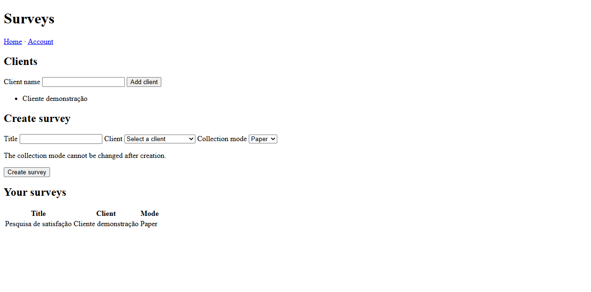
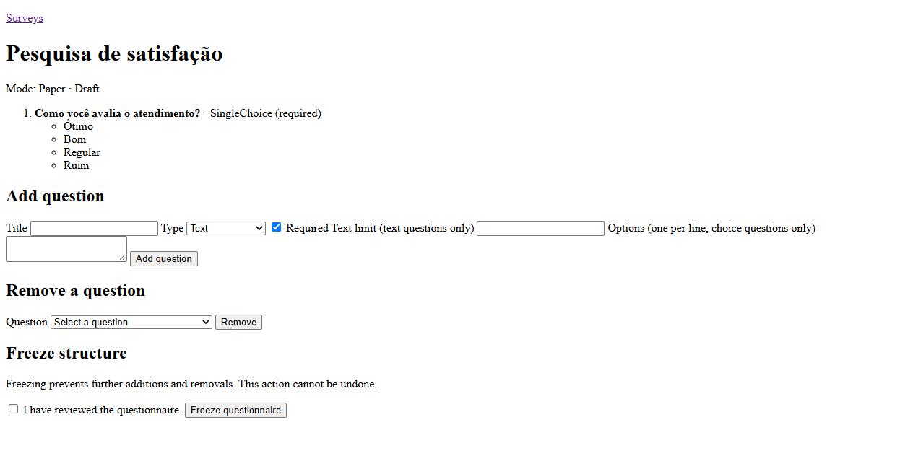
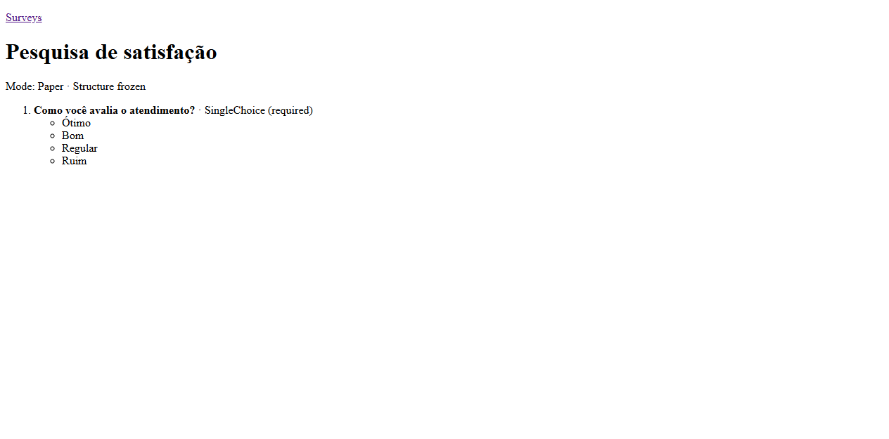
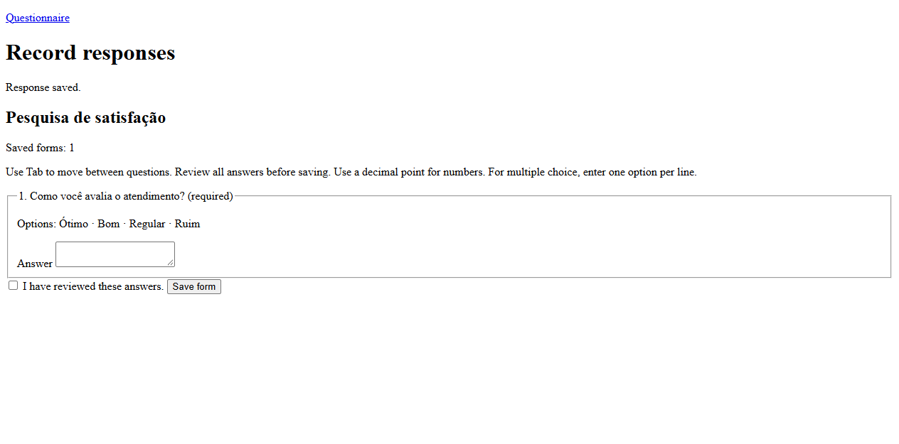

# Capturas de tela

As capturas serão adicionadas conforme as versões funcionais forem verificadas. e cada imagem representa uma interface real da versão correspondente, sem dados pessoais.

## Catálogo de clientes e pesquisas

Criação de clientes e pesquisas com modalidade fixa. Captura feita após verificar o cadastro pela interface, usando dados fictícios. A interface está em evolução.

## Editor de questionários

Inclusão e remoção de perguntas tipadas, opções e congelamento após revisão. As capturas mostram dados fictícios no sistema em execução.

## Digitação manual de fichas

Ficha revisada e salva com confirmação e contador de respostas. Dados fictícios, capturados na aplicação em execução.

